# SoFact

**Describe a product. Get a verified one — or a precise account of why you did not.**

SoFact is a software factory for people who want to *imagine* a platform and then
actually have it built. It interrogates a vague goal until it is falsifiable, compiles
it into a contract whose every clause names the oracle that would check it, hands the
building to a coding agent, and then verifies the result **independently of whoever
produced it**.

SoFact contains no coding loop. It is the control plane around one: the part that
decides what "done" means, and the part that refuses to take a producer's word for it.

```sh
uv tool install git+https://github.com/nyimbi/sofact.git
sofact
```

That is the whole entry point. It asks you a question and keeps asking until your
answer can be tested.

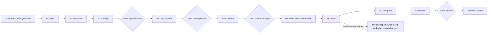

Ten phases, four human gates. A gate sits only where no oracle can decide. Every
phase transition is an append-only ledger entry, so "where is this project" is a fold
over the log rather than a status someone typed.

## The problem

Coding agents are good at writing code and bad at telling you whether it works. Ask one
to build a feature and you get a diff plus a confident summary; the summary is the part
that is not evidence. Two failure modes follow, and they are the ones this project
exists to remove:

- **You cannot tell "done" from "looks done."** A session that ran out of context, hit a
  refusal, or silently lost its tools still exits `0` and still says it finished. Measured
  on `claude` 2026-10-12: run with `--tools read,write`, it accepts the flag, reports
  `terminal_reason: completed`, and gives the producer **no tools at all** — the names are
  capitalised. Nothing in the exit code says so.
- **The spec drifts from the build.** By the time there is code, the intent lives in your
  head, the requirements live in a ticket, and the tests were written by the same process
  that wrote the code. Nothing connects them.

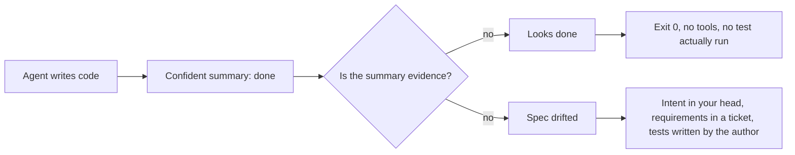

SoFact's answer is a single rule, enforced by the type system rather than by discipline:
**no oracle, no autonomy** ([ADR-0009](docs/adr/0009-no-oracle-no-autonomy.md)). A clause
without a machine-checkable acceptance criterion cannot exist in a contract, so it cannot
be built, and it cannot be claimed. What you get at the end is not a green checkmark; it is
a report naming every clause that was verified, every clause that was not, and exactly what
would change each one.

The rule has a second half: autonomy is a function of oracle strength, and the function has
a ceiling. `AutonomyLevel` runs L0 to L5, but `ceiling_for_rank` never returns L5 — it
returns L4 for oracle rank ≤ 2, L3 for rank ≤ 4, and L2 otherwise. A contract containing an
uncovered clause is capped at L2, and the highest level anything can be granted is L4. L5
is representable in the type and unreachable in the machine, which is the point: the
strongest oracle available is a property (rank 1), and even that buys a human in the loop,
not its absence.

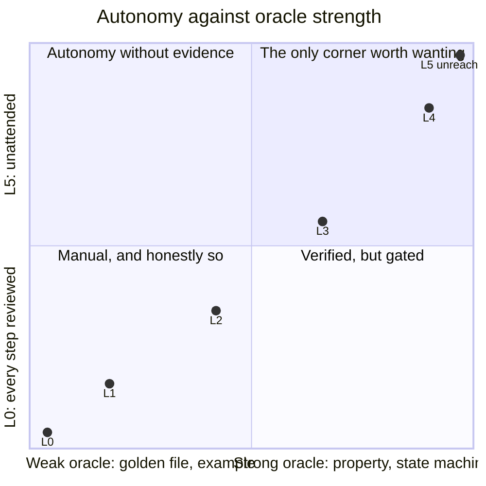

The ranks are concrete: property 1, state machine 2, contract 3, metamorphic 4, schema 5,
example 6, golden 7. Only ranks 1–5 count as *covering*, so a suite of golden-file
comparisons buys L2 however many of them there are. Moving up the vertical axis requires
replacing oracles, not adding tests.

## See it work

Elicitation is a deterministic questionnaire. The model advises; it does not decide
([ADR-0008](docs/adr/0008-the-model-is-advisory-only.md)). Answers are checked against
floors — a length, a requirement that the oracle dimension name a real checking mechanism,
and a requirement that the scale dimension name a quantity — so a non-answer is refused
rather than recorded. Here the goal is stated, three dimensions resolve, and then a
plausible-sounding answer is rejected because it describes an outcome and names no way
to check it:

```text
$ sofact
What do you want to build?: Every reminder appears in the dashboard within 60 seconds
of being scheduled.

[1/8] outcome
  What observable state change tells you this worked?
  ↳ Without an observable outcome there is nothing to test, so there can be no oracle
    and no autonomy above L0.
  :   ✓ resolved

[4/8] oracle
  How would a machine check the outcome, without asking you?
  ↳ This is the load-bearing question. An answer must name a real checking mechanism —
    a test, a property, a query, a digest — because a description of confidence is not
    an oracle.
  :   ✗ does not name a checking mechanism; expected something like one of: test,
      assert, property, invariant, exit code, hash, … (a statement of confidence is
      not an oracle)

  advisor: What machine-readable signal—DOM selector, API response field, or log
  event—proves the reminder is displayed, and where is the scheduling timestamp
  recorded for comparison?
  (answer again to replace it)
```

The advisor line is the model's and varies run to run; the `✗` line above it is the floor,
and it does not. Answer the oracle question properly and the interrogation closes. A
contract then assigns one oracle to every stem, and reports the ceiling those oracles can
support:

```text
$ sofact contract --command 'pytest -q'
contract 01a136fc-097a-7aa6-aeb7-6e4f5e5ce2f6 v1
  7 clause(s)
  weakest oracle rank 3 → ceiling L3
  ground-truth debt 0%
```

Run the oracles and the verdict is a fact about a run, not a claim about the code. Here
the workspace held no test suite, so `pytest -q` exited 5 — and the verdict says so, per
clause:

```text
$ sofact run --workspace ./ws && sofact verify
verdict VIOLATED
  contract 01a136fc-097a-7aa6-aeb7-6e4f5e5ce2f6 @ e976faedf2d4
  ceiling L3 from weakest oracle rank 3
  ✗ The dashboard shows the reminder row within 60 seconds of it being scheduled
      exit code 5, expected 0
  ✗ The end user reads the dashboard
      exit code 5, expected 0
  ✗ a scheduler calls the store API to enqueue a reminder
      exit code 5, expected 0

Not verified. Only an all-satisfied report grants autonomy — an unrun oracle is
not a passing one.
```

Omit `--command` and the factory does not guess an oracle. It reports **100%
ground-truth debt** and caps the ceiling, because a clause nothing can check is a clause
nothing has checked.

## Install

Requires **Python ≥ 3.12** and [uv](https://docs.astral.sh/uv/).

```sh
uv tool install git+https://github.com/nyimbi/sofact.git   # install the `sofact` command
```

Or from a checkout, for development:

```sh
git clone https://github.com/nyimbi/sofact.git
cd sofact
uv sync
uv run sofact
```

State lives in `./.sofact`, or `$SOFACT_HOME`. Nothing is written outside it, no
containers are used ([ADR-0005](docs/adr/0005-no-container-runtime.md)), and the only
network egress is the model you configure.

Two files carry that state. `ledger.jsonl` is the whole project: an append-only,
hash-chained log whose entries are the only truth, and `state.fold(entries)` is a pure
function of them — nothing is cached beside it, so a ledger copied to another machine
reproduces the same `ProjectState`. `ledger.lock` serialises writers so two commands
cannot interleave entries and break the chain. Delete the directory and the project is
gone; that is deliberate, because a state file that can be edited by hand is a state file
that can disagree with its own history.

**The model is optional.** SoFact talks to any OpenAI-compatible endpoint and defaults to
Ollama on `http://localhost:11434/v1`. If nothing is listening, it degrades to a plain
deterministic questionnaire — the floors, the gates and the verdicts are not model-driven,
so the product works without one. Point it elsewhere with `SOFACT_MODEL` / `SOFACT_BASE_URL`.

## The pipeline

Ten phases, four human gates. A gate is placed only where **no oracle can decide** — the
machine checks run and are reported, and then a person approves, naming themselves. The
enum is closed and ordered (`PHASE_SEQUENCE = tuple(Phase)`), so "which phase are we in"
is a value rather than an inference from whichever ledger rows happen to exist.

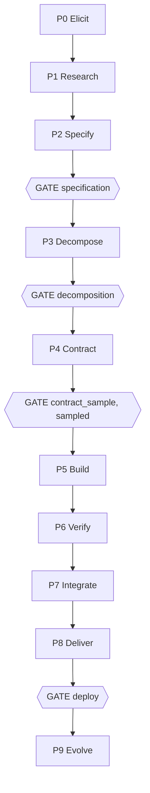

The gate is a *phase* state, not a review step bolted between phases: P2, P3, P4 and P8
are members of `PHASE_GATE`, and `PHASE_GATE_INVERSE` is derived from that mapping so a
gate cannot be attached to the wrong phase by a second hand-written table. Four, not ten,
because a gate at P5 or P6 would restore the per-diff review bottleneck the product
exists to remove. P4's gate is `contract_sample`: it reads a sample of the per-clause
oracle suite rather than the whole suite, which is the sense in which it is sampled.

A phase moves through four states, and the one that matters is the third:

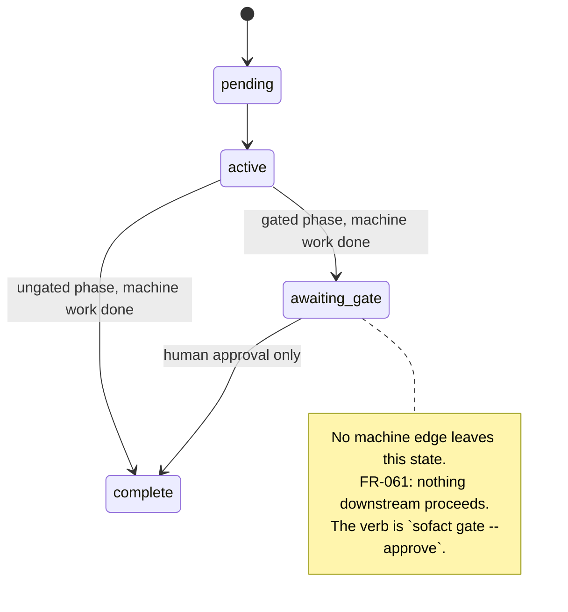

A gated phase whose machine work is done is neither `complete` nor merely `active`. It is
`awaiting_gate`, and collapsing that into `active` would make a phase that cannot advance
look identical to one that is working — the distinction an operator most needs to see.

| Phase | What it produces |
| --- | --- |
| **P0 Elicit** | Intent clauses, from a Socratic dialogue with a deterministic resolution gate. |
| **P1 Research** | Cited findings that validate, invalidate or deepen the premise — before you build. |
| **P2 Specify** | A specification: one requirement per clause, each carrying that clause's oracle. **Gate.** |
| **P3 Decompose** | Modules, interfaces and a dependency DAG, derived from the contract with no model call. **Gate.** |
| **P4 Contract** | A per-clause oracle suite with its strength measured. **Gate** (`contract_sample`, sampled). |
| **P5 Build** | Goal sessions dispatched to a harness, one branch per module. |
| **P6 Verify** | Oracle results, out of process. The verdict takes no completion claim. |
| **P7 Integrate** | Build order, import discipline, interface and model conformance, system criteria. |
| **P8 Deliver** | The delivery report: artefacts, traceability chain, unverified clauses, handover. **Gate.** |
| **P9 Evolve** | *Not built.* The escape measurement it consumes exists; the scorecard and the lane adjustment do not. |

Every phase's state, and the argument behind it, is in [**`docs/phases.md`**](docs/phases.md).
That file is the long form of this table, moved there from it rather than rewritten, so the
detail has one home. A test asserts the two agree on which phases exist and that every gate
the code defines is named on this page — a reference describing a phase the code lacks, or a
front page silently dropping one, fails rather than reads.

Each gate has one phase and one verb that passes it. The mapping is the enum, not a
convention:

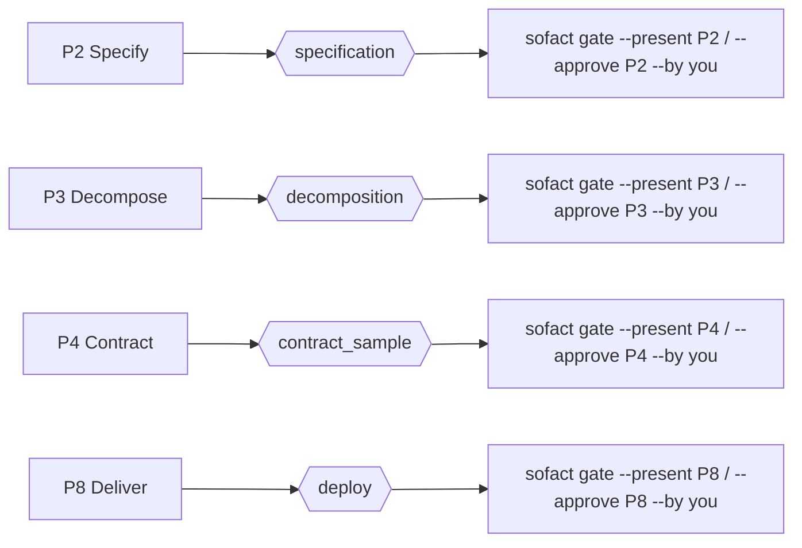

Two commands make the machine's own position legible:

```sh
sofact phase    # where the pipeline is; exits non-zero while a gate is open
sofact status   # the goal, the phase, readiness per dimension, ledger health
sofact tui      # the same facts on one screen, plus the ledger and the next move
```

`sofact tui` is the dashboard: the phase machine, the open gate's checks, readiness per
dimension, the ledger, the last driver run, and the one command that would let the
pipeline continue — all on one screen, re-read with `r`. It can do the two things §3.3
keeps human (answer a question, approve a gate you have read) and nothing else. It cannot
carry the pipeline past a gate: `b` runs the driver, which stops at every gate by
construction, and `approve_gate` refuses a failed machine check regardless of who asks.

A gate cannot be passed by anything except a person naming themselves, and an approval
cannot waive a failed machine check:

```sh
sofact gate --present P2            # the machine half: run the checks, report them
sofact gate --approve P2 --by you   # the human half: recorded with who and when
```

The two halves are separate rows. `--present` reports what the machine found; `--approve`
records a judgement over that report. A failed check is still a failed check after an
approval — the gate has two halves and cannot be passed on one.

## The front door

The whole pipeline is reachable from one description of what you want:

```sh
sofact speak interview.m4a        # a recording → a transcript → a goal (FR-168)
sofact elicit                     # revise a resolved answer; FR-068's recovery half
sofact search                     # web search, queries composed from the goal (FR-174)
sofact research                   # deep research, dispatched to a harness (FR-167)
sofact competitors                # the competitive baseline, as a cited artefact (FR-169)
sofact spec-doc                   # SPECIFICATION.md, every requirement annotated (FR-171)
sofact build                      # drive the pipeline; stop at every gate (FR-172)
```

End to end, with the human stops drawn where they are:

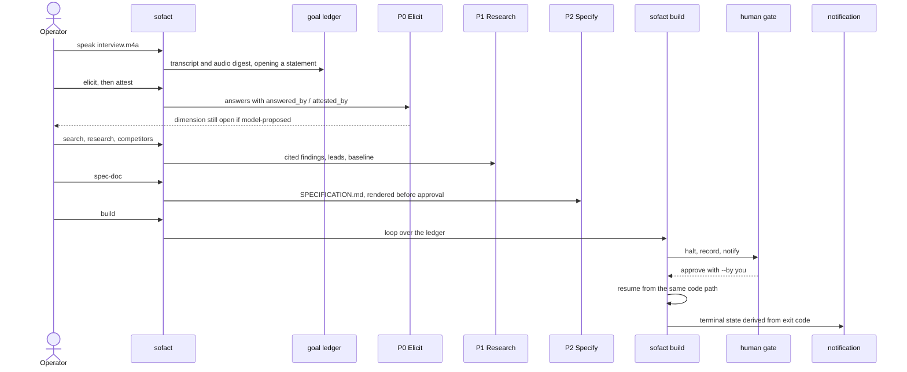

**Search is a capability of this product, not a request to someone else.** `sofact search`
composes queries from the goal's own words *before* any provider runs, asks a **declared**
provider — an argv template in `SOFACT_SEARCHER_SPECS`, so no engine is bundled and no
socket is opened by this code — and records every hit as a **lead** at the weakest
verification rung. A search result is a place to look; it is never evidence. A hit with no
url is refused outright, and a query that failed is recorded as failed rather than as a
domain with nothing in it, because those two call for opposite responses.

**A specification document is a rendering of a fact.** `SPECIFICATION.md` is written at P2 —
the artefact the first gate is a gate *on* — **and written before the approval, not after it**:
the annotation exists to be read in order to decide, so the requirement is that the
specification has been *gated*, not that it was approved. The gate as it stood is carried on
the document as `gate_failures`, recorded rather than looked up afterwards, because the gate is
recomputed on every approval and a document that re-derived it would report the gate that was
finally passed instead of the one the approver was shown. Every requirement carries its
provenance:
the clause stem it descends from, that stem's elicitation answer and **whether a human read
it**, the research verdict and its evidence, the competitor capabilities it is positioned
against, the exceedance it belongs to, and its oracle's class. A requirement whose answer a
human never attested is marked **unattested** in the document, and the marker is derived
from the ledger rather than passed in — so the document cannot be rendered clean over a
specification nobody approved.

**A model-proposed answer does not resolve a dimension.** `sofact attest <answer-id> --by
you` is the human half, and an answer whose `answered_by` is `model:`-prefixed is reported
as open until a person attests it. The floor under P0 stays deterministic; what changes is
that a plausible paragraph a model wrote can no longer clear it on the operator's behalf.
This is the one defect the feature would otherwise introduce — a requirement nobody said,
in a specification the operator "approved", with nothing downstream failing.

**`sofact build` stops at every gate and says which.** It is a loop over the ledger rather
than a held process, so `--resume` is the same code path as a cold start and a driver killed
mid-run resumes correctly. It has **no code path that advances a gate** (FR-061): at each
gate it records a halt, notifies, and returns. Running it twice is a no-op the second time.

**A notification that was not sent is not a notification.** `delivered` is derived from the
exit code and never declared, the row is written whether or not a process launched, and the
subject is composed from the run's terminal state — so a run stopped at a gate can never
produce a message reading "built".

## How it works

Three mechanisms carry the whole design. The **ledger** is the only mutable thing: every
fact is an appended, hash-chained event, and all state is a pure fold over that log. The
**oracle ladder** decides what a clause is worth: a rank from 1 to 7, a coverage boundary
at rank 5, and a confidence derived from the oracle rather than asserted by anyone. The
**autonomy ladder** turns those facts into a permission: a ceiling from the weakest
oracle, composed with the deployment's isolation, and lowered by the one number no
producer wrote — the escape rate.

### The ledger is the system

Every fact is an append-only, hash-chained event. `ledger.jsonl` lives in `./.sofact` or
`$SOFACT_HOME`, one `LedgerEntry` per line with fields `index, at, kind, payload,
prev_hash, entry_hash`. There are 41 `LedgerKind` members, from `goal.created` to
`search_scan.recorded`.

`entry_hash` covers `prev_hash`, so altering any entry invalidates every entry after it —
the log is tamper-*evident*, not merely append-only ([ADR-0003](docs/adr/0003-the-ledger-is-append-only-and-hash-chained.md)).
`verify_chain` recomputes each entry and checks three things: the index is the expected
position, `prev_hash` equals the predecessor's `entry_hash`, and the recomputed hash
equals the recorded one. The first divergence names `broken_at` and the reason.

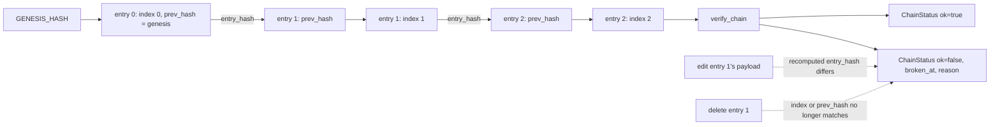

Appends take an exclusive `flock` on a sibling lock file, not on the log itself
(`ledger.py:159`, [ADR-0029](docs/adr/0029-an-append-takes-an-exclusive-lock.md)). `flock`
binds to an inode, and the log is created and unlinked by other code, so a dedicated lock
file is what makes every writer contend on one inode. The new entry is chained onto the
tail as it is *under the lock*, so a second writer chains onto the first rather than onto
the log both read before either wrote.

**State is a pure fold.** `fold(entries) -> ProjectState` (`state.py:114`) replays the log
in order: same entries in, same state out, no I/O, no clock, no ordering dependence beyond
the log's own order. That purity is what makes replay meaningful — if state could be
assembled by anything other than the log, the log would not be the record of what happened.
An unknown kind cannot reach the fold: `LedgerEntry.kind` is typed `LedgerKind`, so a line
from a newer build fails validation in `Ledger.entries()` and surfaces as
`LedgerCorruptError` rather than being skipped.

The 41 kinds do not all fold the same way, and the difference is deliberate rather than
incidental:

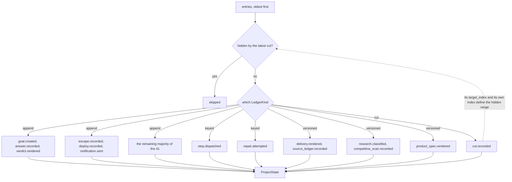

| Fold behaviour | Kinds | Why |
| --- | --- | --- |
| **append** | the majority of the 41 | Every row is a fact; the fold accumulates them. |
| **keyed, last write wins** | `step.dispatched`, `repair.attempted` | A row is written when work starts and settled when it ends. The log keeps both; the fold reports the settled value, and position stays the first appearance. |
| **versioned, latest operative** | `delivery.rendered`, `source_ledger.recorded`, `research.classified`, `competitive_scan.recorded`, `product_spec.rendered` | Re-rendering supersedes without erasing, so a deploy gate approved against a report stays readable after the report is re-rendered. |
| **collected, pre-applied** | `cut.recorded` | Read before the loop, because the latest cut decides what the loop skips. |
| **never hidden** | every `cut.recorded` row | The skip exists to un-do work; a cut is the record of a decision about how to read the log. Hiding one would swallow the reason the rollback happened. |

The keyed group exists because a row can be written twice and the later one is more
complete: `step.dispatched` is written when a session starts and settled when FR-141's
wave integration merges the worktree back, and `repair.attempted` is settled against the
verdict its session's check rendered. The log keeps both rows; the fold reports the
settled value, and position stays the dispatch's first appearance so log order still means
when it started rather than when it was last amended. The versioned group exists because
re-rendering supersedes without erasing: a deploy gate approved against a delivery report
must stay readable after the report is re-rendered.

**A rollback is a reading rule, not a deletion.** `sofact rollback --to 12 --reason "…"`
appends a `Cut` and nothing else. The log grows, the chain still verifies, and the work the
rollback hides is still there to be read
([ADR-0034](docs/adr/0034-a-rollback-is-a-reading-rule-and-the-log-keeps-what-it-hides.md)).

```sh
sofact ledger          # the append-only event log
sofact verify-ledger   # recompute the hash chain; exit 1 if it does not verify
```

`_hidden_by_latest_cut` (`state.py:80`) reads the **latest** cut as a rule: fold through
its `target_index`, skip every entry between the target and the cut row, then fold whatever
follows normally. So a cut means "the state as of entry N, plus whatever I have done since
deciding that". Only the latest cut applies — two cuts whose skips composed would make
current state depend on the history of rollback decisions rather than on one decision.

The cut rows themselves are never hidden. The skip exists to un-do *work*, and a cut is not
work — it is the record of a decision about how to read the log. Hiding one would let the
skip swallow the *reason* for a rollback, leaving exactly the unexplained gap `Cut.reason`
exists to prevent.

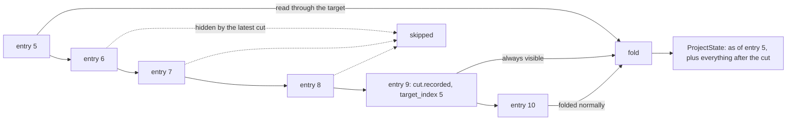

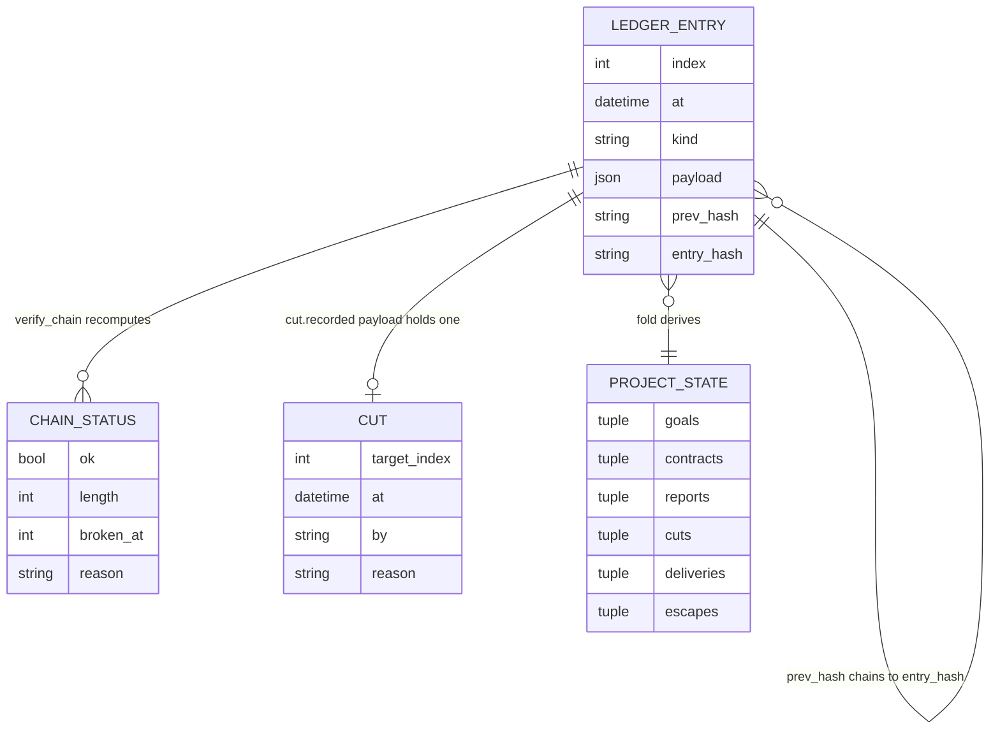

### The oracle ladder

A clause is a falsifiable unit with a non-nullable `OracleDeclaration`. The oracle classes
are ranked, and the rank is a statement about what the check derives its expectation from
(FR-103):

| Rank | `OracleClass` | What the check is derived from |
| --- | --- | --- |
| 1 | `property` | an invariant the contract asserts |
| 2 | `state_machine` | the legal transitions |
| 3 | `contract` | a signature or protocol |
| 4 | `metamorphic` | a relation between operations |
| 5 | `schema` | the system model |
| 6 | `example` | a sample of behaviour |
| 7 | `golden` | a recording of one run |

`COVERING_ORACLE_MAX_RANK = 5` is the coverage boundary, and the line is there because
ranks 1–5 derive a check from something the contract already asserts while ranks 6–7 do
not. FR-103's own strength column calls them "sample, not coverage" and "detects change,
not wrongness". A clause covered only by an example is a clause nothing establishes.

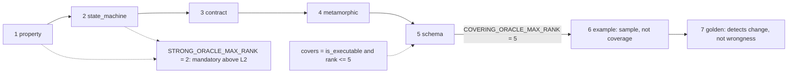

`covers` is a conjunction, and each half was missing from one consumer before the property
existed. `Contract.ceiling` read the rank alone, so a rank-1 property *intention* — prose
with no command — granted L4 to a contract nothing could run. `ground_truth_debt` read
executability alone, so a rank-6 example with a command reported zero debt. A weak oracle
that runs measures the wrong thing; a strong oracle that does not run measures nothing.

**Confidence is derived, never stored** (FR-067,
[ADR-0078](docs/adr/0078-a-clauses-confidence-is-derived-from-its-oracle.md)). `ClauseConfidence`
is a plain `@property` with three values, because the underlying facts are three distinct
states and a score would blur the one that matters:

- `covered` — `oracle.covers`: it runs and is strong enough.
- `weak` — it runs and is too weak: ranks 6–7.
- `stated` — no command at all: an intention.

A producer-filled `confidence` would be a self-assessment, and this tree refuses
self-assessments. What is quantified is a fact the log already holds. `WEAK` is not a low
`COVERED`, it is a different defect from `STATED`; a 0.6 would make them the same number.

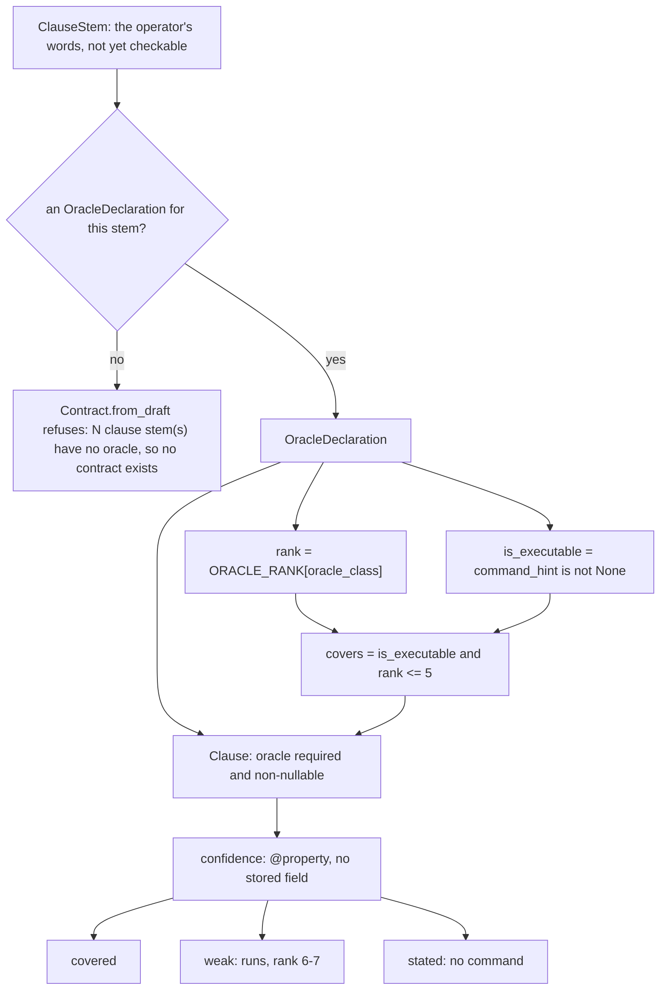

A stem with no oracle produces no clause at all, and the refusal names the stems:
`"N clause stem(s) have no oracle, so no contract exists: <ids>"`. "Unverifiable" is only
actionable when it is specific.

**Ground-truth debt is the fraction no oracle covers.** `Contract.uncovered_clauses` is the
complement of `covers` over the clause set; `ground_truth_debt` is its size divided by the
clause count. `0.0` is the only good value. Anything above it means the contract's autonomy
ceiling is a claim about clauses that were never established, which is why
`Contract.ceiling` caps at `UNCOVERED_CLAUSE_CEILING = L2` when the debt is non-zero
(FR-109).

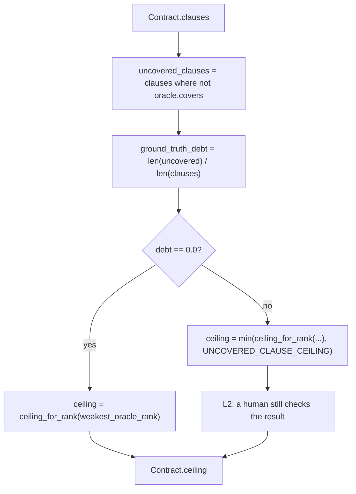

The rank cap and the coverage cap are different refusals with different reach: the rank cap
applies to a contract whose *weakest* clause is weak, and the coverage cap applies to a
clause covered by nothing at all. The ceiling is set by the weakest clause, not the
strongest — a contract is only as verifiable as its least verifiable part.

**The pinned subject is `content_hash`.** `Contract.content_hash` hashes the clauses'
`model_dump(mode="json")`, so verification can prove *which* contract it verified and
post-hoc edits are detectable (FR-139). `sofact integrity` re-verifies the pinned contract,
oracle-set and goal-text hashes.

### Autonomy

The ladder is L0 (manual) through L4. **L5 is representable but unreachable**: the spec
declines to offer a dark factory, and the guard lives in the deriving function rather than
in the enum, because a type that can express a level it will never grant is a type that can
be misused. `HIGHEST_GRANTABLE = L4`; `ceiling_for_rank` never returns L5.

`ceiling_for_rank` maps the contract's **weakest** oracle rank to a level: rank ≤
`STRONG_ORACLE_MAX_RANK` (2) admits L4, rank ≤ 4 admits L3, anything weaker caps at L2.
Rank alone, deliberately — the function has no oracle to consult, so FR-109's executability
cap is applied where the oracle is known, in `Contract.ceiling` and
`OracleDeclaration.covers`.

Routing is §5.1's three lines, computed rather than restated:

```text
admissible(lane) = intent_derivable AND oracle_exists AND blast_radius_bounded(deployment)
ceiling(lane)    = min( f(oracle_strength), g(blast_bound), h(deployment_isolation) )
level(lane)      = min( ceiling(lane), floor(concerns) )
```

Three readings this composition refuses, each a way the function could lie. **An
unmeasured strength is not a low one**: `oracle_strength_ceiling` returns `None` when no
clause of the lane has a measurement that survived FR-105's floor, and `None` is not L1 —
rounding it to L1 would report a lane nobody measured as one measured badly, and would let
the gate pass on the absence of evidence. **A concerns floor may only lower**, and a lane
§14 names no concern for has *no* floor, not L0. **Exceeding a blast bound fails the lane**
rather than lowering it (FR-026), which is why `g` is discharged at admission: §5.2
supplies no table mapping a bound to a level, and inventing one would be writing policy the
spec does not state.

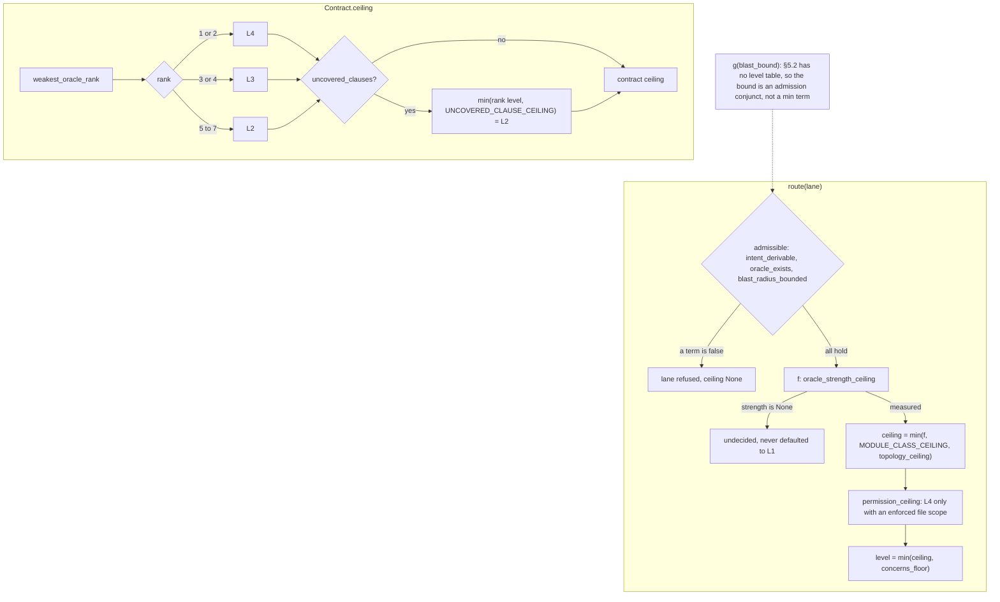

`MODULE_CLASS_CEILING` is the class ceiling from §14 — G1/G2 at L4, G3/G4 at L3, G5/G6/G8
at L2, G7 (auth, secrets, payments or PII) at L1. It is a property of the class because it
is a statement about what kinds of oracle are manufacturable for that kind of code, and the
contract's measured ceiling applies on top: a G7 module cannot inherit L4 because someone
wrote strong oracles for it. `permission_ceiling` caps at L3 unless the lane's file scope
is declared *and enforced by permission* (FR-027), and it caps rather than refuses — FR-124
requires a T1 deployment with no isolation boundary to still run.

**The escape rate is the one number no producer authored.** The producer writes oracles and
modules; it does not write deploys or reverts, which is what makes this the factory's only
ground truth (FR-021–023,
[ADR-0054](docs/adr/0054-the-escape-rate-is-the-one-number-no-producer-authored.md)).
`sofact escape` records a revert, hot-fix or incident against a deployed change;
`sofact escapes` folds the ledger into a per-lane rate — distinct defects over deployed
changes. A lane over its declared budget has its ceiling reduced **one level**, because
§5.4's own modifier unit is −1 level and the ladder is ordinal. The reduction is not
cumulative: it is a function of the current rate, so it lifts when the rate returns. A
recorded override lifts it by name, and the measurement stays visible.

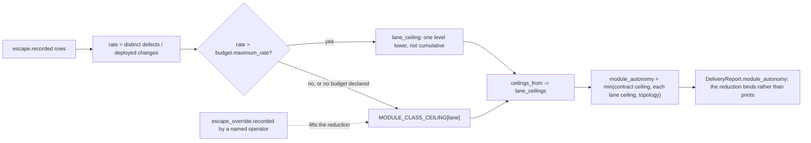

The reduction reaches `module_autonomy` through `lane_ceilings`, composed with §14's class
ceiling by `min` rather than assignment — a G7 lane is L1 and a reduction may lower it to
L0, never raise it. A delivery in a reduced lane therefore *reports* the lower number
rather than claiming one FR-023 has withdrawn. The deploy gate does not refuse on
`over_budget`, and that is a property of FR-023 rather than a concession: the rate is
escapes over deployments, so the only way it returns to budget is by deploying changes that
hold, and a gate that blocked those would make the recovery unreachable.

**And an escape points back at the clause that was misunderstood.** The intent graph holds
the clause, its requirement, its module and its step as vertices, and the delivery chain is
**projected from it** rather than walked a second time — so a hop the graph does not hold
cannot appear in a report
([ADR-0058](docs/adr/0058-the-intent-graph-is-what-the-chain-is-projected-from.md)).
`sofact escape --module <name>` narrows an attribution from the lane to the module that
broke, because a lane is a *class* and a lane-wide answer is a candidate set, not an answer.

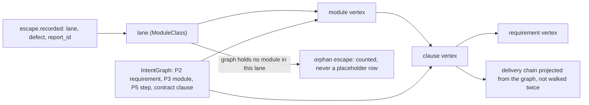

`attributions_for` returns one row per escape that reaches a clause and nothing for one
that does not. An escape naming a lane the graph holds no module for is a gap in the graph,
not an attribution — and the count difference between escapes recorded and attributions
returned *is* the gap. Inventing a placeholder row would hide it.

## The phases in detail

Each phase below names the requirement or ADR that forces it, the verbs that serve it,
and the checks its gate runs. The phase enum is closed and ordered, so "which phase are
we in" is a value in the log rather than an inference from whichever rows happen to
exist.

### P0 — Elicit

The goal is interrogated until it is falsifiable: eight dimensions, each with a
deterministic content floor, and no phase past P0 while one is open (FR-064, ADR-0077).
Resolution is `Readiness.is_ready` — every dimension resolved — and the floors measure
specificity, not enthusiasm: ORACLE requires a named checking mechanism from a fixed
marker list, SCALE requires a quantity, and refusals such as `n/a` do not count.

| Verb | What it does |
| --- | --- |
| `sofact` | Asks the open dimensions, in enum order, one at a time. |
| `elicit --dimension <name> --by <you>` | Revises one resolved answer. FR-068's recovery half: after a return to P0 every dimension is resolved, so the questionnaire would change nothing. |
| `attest <answer-id> --by you` | Records that a person read a model-proposed answer (FR-173). |
| `speak <audio>` | Transcribes speech and opens a goal from it (FR-168). The transcript is a record about a statement, not the statement. |
| `dimensions` | Prints the eight dimensions, their questions and their rationales. |
| `draft` | Drafts clause stems, refusing while any dimension is open. |

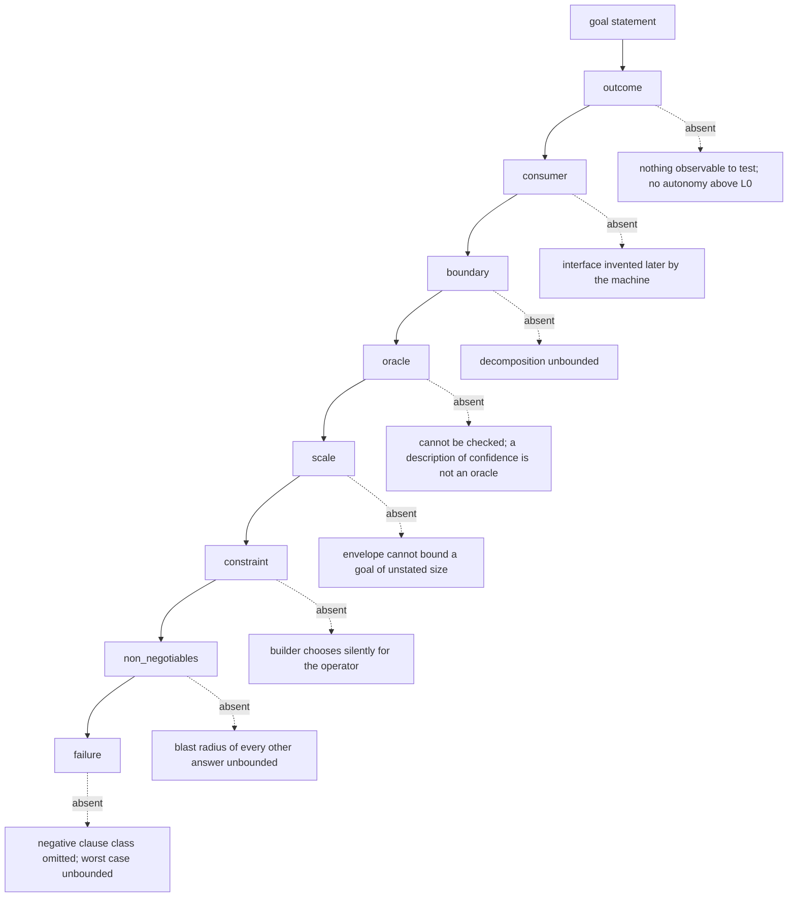

A model may propose an answer. It may clear every floor and still not resolve the
dimension: `answered_by` carrying the `model:` prefix makes `is_model_proposed` true,
and `assess` reports the dimension open until an attestation row names that answer id
(FR-173). The default for the attested set is empty, so a caller that forgets it gets
the refusing answer rather than the permissive one.

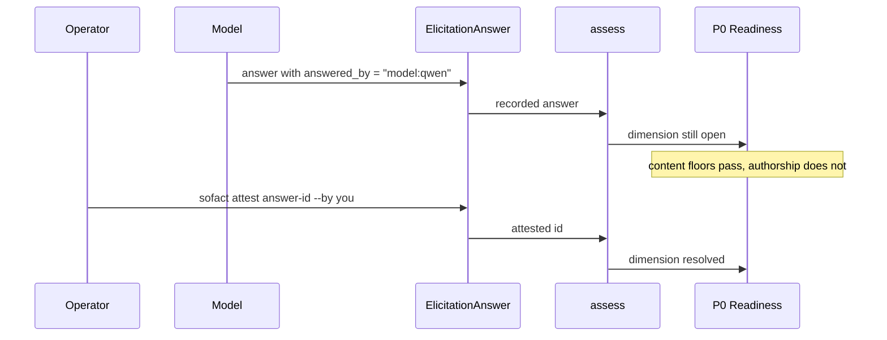

### P1 — Research

Research decides whether the premise survives contact with evidence, before anything is
built on it. `research` authors the session's goal with zero model involvement, dispatches
it, and records the artefacts it left (FR-167); a report with no cited sources is recorded
as a run that found nothing rather than rounded into research that happened.

| Verb | What it does |
| --- | --- |
| `search` | Authors queries from the goal's own words and records every hit as a *lead* at the weakest verification rung (FR-174). A result is a place to look, not evidence. |
| `research` | Dispatches the research session; `--super` asks for the multi-phase loop, `--max-sources` defaults to 5 per clause. |
| `sources` | Prints the source ledger, or reads one out of a run with `--from-run` (FR-070). |
| `classify` | Prints FR-068's verdict on every intent clause, or reads one out of a run. |
| `competitors` | Records the competitive baseline the run produced (FR-169). |

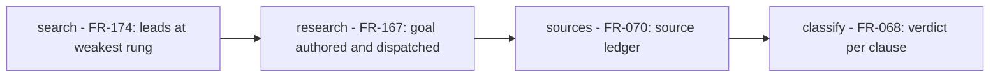

FR-068 has four verdicts and no fifth, because each carries a different action in
`VERDICT_ACTION`, and that table is read by the CLI and the P1 completion rule rather
than restated in prose. Two of the four send the pipeline back to P0; the recovery verb
is `sofact elicit`, which supersedes the contradicted answer so the next draft produces
fresh stems instead of arguing with the old ones.

```mermaid
%% FR-068 ResearchVerdict and VERDICT_ACTION: two of four return to P0
flowchart TD
    V["verdict on one clause"] --> C["validated"]
    V --> I["invalidated"]
    V --> U["unverifiable"]
    V --> D["deepened"]
    C --> P["proceed to P2"]
    U --> FA["proceed as an explicitly flagged assumption"]
    FA --> P
    I --> R0["return to P0: the premise is contradicted and must not be built"]
    D --> R0
    R0 --> E["sofact elicit --dimension <name> --by you"]
```

P1 has no gate. Its stop is the completion rule reading the verdict table: an
`invalidated` or `deepened` clause cannot be advanced past by a reader who skipped a
paragraph.

### P2 — Specify

`specify` proposes one requirement per clause, each carrying a machine-checkable
acceptance criterion, plus the system model, non-goals, assumptions and value hypothesis
(FR-076 through FR-086). It is a *proposal* until approved, and the gate is a hard stop:
`awaiting_gate` has no machine edge out (FR-061).

| Verb | What it does |
| --- | --- |
| `specify` | Proposes the specification for the current contract and runs the gate. `--entity`, `--interface`, `--assumption`, `--value`, `--criterion` declare the model and the rest. |
| `specify --approve --by you` | Records the operator's approval of the proposal (FR-080). |
| `spec-doc` | Renders the annotated product specification: each requirement with the answer it descends from, whether a person read it, and what research concluded (FR-171). |
| `gate --present P2` / `gate --approve P2 --by you` | Presents the machine checks, then records the human half. |

The gate reports every check, including the ones that depend on the operator having
supplied something — a check that cannot pass because nothing was declared is still a
check.

```mermaid
%% FR-076..FR-086: the fourteen P2 machine checks, grouped by the question each answers
flowchart TD
    SP["specify: one requirement per clause"] --> T
    subgraph T["traceability (FR-076)"]
        T1["every_requirement_cites_a_real_clause"]
        T2["every_clause_reaches_a_requirement"]
    end
    subgraph CR["criteria (FR-077, FR-082)"]
        C1["every_requirement_has_a_criterion"]
        C2["testability_reported"]
    end
    subgraph CO["contradiction (FR-081)"]
        K1["no_clause_is_both_asserted_and_denied"]
    end
    subgraph MD["model (FR-078, FR-081, FR-083)"]
        M1["every_entity_is_referenced_by_a_requirement"]
        M2["every_entity_reference_names_a_real_clause"]
        M3["relationships_name_declared_entities"]
        M4["system_model_declared"]
        M5["every_interface_cites_a_real_clause"]
    end
    subgraph DE["declarations (FR-079, FR-085)"]
        D1["non_goals_declared"]
        D2["assumptions_declared_and_falsifiable"]
        D3["value_hypothesis_is_falsifiable"]
    end
    subgraph RP["reporting (FR-116)"]
        R1["system_criteria_reported"]
    end
    T --> G{"all pass?"}
    CR --> G
    CO --> G
    MD --> G
    DE --> G
    RP --> G
    G -->|"no"| STOP["awaiting_gate: --approve cannot waive a failed check"]
    G -->|"yes"| AP["operator approval, named"]
```

Two checks *report* rather than fail, and the distinction is the requirement's own:
`testability_reported` permits a criterion that only a human can evaluate, and counts
its cost against the human budget (FR-082); `system_criteria_reported` says a project
with no system-level criterion is a measurement, not a defect (FR-116).

```mermaid
%% FR-076/FR-078/FR-083: Specification and the types it aggregates
erDiagram
    Specification ||--o{ Requirement : "requirements"
    Specification ||--|| SystemModel : "system_model"
    Specification ||--o{ Assumption : "assumptions"
    Specification ||--o| ValueHypothesis : "value_hypothesis"
    SystemModel ||--o{ SystemEntity : "entities"
    SystemModel ||--o{ SystemInterface : "interfaces"
    Requirement }o--o{ Clause : "clause_ids"
    SystemEntity }o--o{ Clause : "clause_ids"
    SystemInterface }o--o{ Clause : "clause_ids"
    Assumption {
        string statement
        string refuted_by
    }
    ValueHypothesis {
        string effect
        string beneficiary
    }
```

### P3 — Decompose

`decompose` proposes modules from the contract alone — deterministically, with no model
call. A contract with no declared interfaces yields one module per clause (ADR-0025);
where P2 declared interfaces, one module per declared surface, because FR-091's minimum
is read off the model rather than chosen (FR-091). Dependencies come from the oracle
class, not from reading English: a `SCHEMA` or `PROPERTY` clause describes a shape other
clauses are checked against, so the modules whose oracles are contract-level depend on it.

| Verb | What it does |
| --- | --- |
| `decompose` | Proposes modules, interfaces and a dependency DAG, and runs the gate. |
| `gate --present P3` / `gate --approve P3 --by you` | The gate has two halves and cannot be passed on one: the machine checks are facts, and `--approve` records the operator's separate judgement (FR-087/FR-061). |
| `plan` | Refuses to run past an unapproved gate. |

```mermaid
%% FR-091 grouping, ADR-0025 one module per clause, FR-089 acyclicity, FR-092 build order
flowchart TD
    CL["contract clauses"] --> IG{"model declares interfaces?"}
    IG -->|"no"| M1["one module per clause"]
    IG -->|"yes"| MG["one module per declared surface"]
    M1 --> DAG["depends_on from oracle class: SCHEMA/PROPERTY foundations"]
    MG --> DAG
    DAG --> CYC{"acyclic?"}
    CYC -->|"yes"| BO["build_order: topological order"]
    CYC -->|"no"| F["gate fails: acyclic"]
    BO --> G["P3 gate"]
```

The gate checks: `acyclic`, `build_order_exists`, `every_module_traces_to_a_requirement`,
`every_requirement_traces_to_a_module`, `every_module_cites_a_real_clause`,
`every_module_has_completion_criteria`, `interface_count_minimised`,
`every_module_declares_a_budget`, `within_delivery_envelope`. `architecture_is_right` is
deliberately absent: §7.1 says there is no oracle for it, so a machine check named that
would be the machine claiming the operator's half of the gate.

`within_delivery_envelope` measures the proposal against §1.3 (FR-057/NFR-025): over a
ceiling fails and names the dimension, under a floor is reported and passes, because
§1.3's numbers are targets and a floor gate would refuse to build anything smaller than
a platform (ADR-0039). The four dimensions nothing in the log measures are named as
unmeasured rather than counted as satisfied.

### P4 — Contract

`contract` assigns one oracle to every clause stem. `--command 'pytest -q'` assigns that
command to every stem; without it, every clause carries an advisory oracle with no
command, and the contract reports **100% ground-truth debt** rather than hiding it
(FR-108). Debt above zero means the autonomy ceiling is a claim about clauses that were
never run, and the weakest oracle rank caps the ceiling (FR-109).

| Verb | What it does |
| --- | --- |
| `contract --command <cmd>` | Builds the contract: one oracle per stem, `content_hash` over the clause set, `oracle_set_hash` over the oracles alone. |
| `audit` | Runs every probeable oracle against an empty workspace and reports the ones that passed anyway (FR-107). |
| `gate --present P4` / `gate --approve P4 --by you` | Presents the single sampled check and records the approval. |

```mermaid
%% Contract construction: stem + oracle -> Clause -> content_hash; the no-command path
flowchart TD
    S["ClauseStem"] --> A{"--command given?"}
    A -->|"yes"| O["OracleDeclaration naming that command"]
    A -->|"no"| SG["suggest_oracle: advisory class, no command"]
    O --> C["Clause: oracle required and non-nullable"]
    SG --> C
    C --> H["Contract.content_hash: SHA-256 of the clause set"]
    C --> OSH["oracle_set_hash: the oracles alone"]
    SG --> D["ground-truth debt 100%: no machine can run it"]
    D --> R["ceiling capped at L2 (FR-109)"]
```

The two hashes exist separately because FR-139 pins the contract, the goal text and the
oracle set independently, and a single hash can only say *that* something moved. "The
oracles changed" is the one sentence a producer must never be able to cause quietly.

P4's gate is sampled (§3.3) and presents one check, `oracles_are_not_satisfied_by_nothing`,
from the oracle audit. An oracle that returns `SATISFIED` against an empty workspace
establishes nothing, so the clause's coverage is not evidence; a `VIOLATED` result is the
good case, and `INSUFFICIENT` is not a finding at all.

### P5 — Build

`plan` compiles the approved contract into ordered goal sessions with pinned hashes
(FR-136/FR-139), and `dispatch` runs them in waves, one out-of-process session per step,
on a branch per module (FR-100). The branch is established before the session starts and
SoFact commits the session's work onto it when the session ends, so "never in place" is a
fact in the log rather than a line in a prompt.

| Verb | What it does |
| --- | --- |
| `plan` | Compiles ordered goal sessions; refuses past an unapproved P3 gate. |
| `probe` | Attempts a harness and records what was observed, including `sandboxable` (FR-148). |
| `select` | Chooses a harness from what has been measured (FR-147). |
| `dispatch` | Runs waves; `--all` runs every step, `--concurrent` isolates a wave, stops at the first refuted wave (FR-142/FR-163). |
| `repair` | Hands each refuted clause back to the producer, bounded per clause. |
| `attempts` | Reports what the repair loop cost: attempts, tokens, wall clock (FR-102). |
| `composition` | Records or checks the harness's frozen plugin composition (FR-154). |

`dispatch` refuses until a profile exists, because an unmeasured harness is a guess.
`--concurrent` gives each step a worktree of its own (FR-141), but only when every step
in the wave is owned by a *distinct* module: a step no module owns has no worktree to be
given, and two steps of one module would share a branch and therefore a directory
(ADR-0033). One unisolatable step means the whole wave runs sequentially. The main tree
holds the integration line, and each step's branch is merged back before the next wave
is judged.

```mermaid
%% FR-100 branch per module vs FR-141 worktree per module; --concurrent isolates a distinct-module wave only
flowchart LR
    W["wave: ordered steps"] --> Q{"every step owned by a distinct module?"}
    Q -->|"yes and --concurrent"| WT["worktree per module on its branch"]
    WT --> M["merge each branch onto the integration line"]
    Q -->|"no, or sequential"| BR["branch per module in the shared tree"]
    BR --> C["commit the session's work on the module's ref"]
    M --> NEXT["judge the next wave"]
    C --> NEXT
```

The repair loop is bounded because an unbounded retry is the most expensive failure mode
available to an unattended factory: it consumes wall clock, the binding resource
(FR-101). `DEFAULT_STEP_ATTEMPTS` is 1, so retrying is an operator decision made by
dispatching again, never a default. The repair goal carries the refutation diagnosis and
the attempt counter in its text, and the verdict is re-rendered from a fresh `run`, so a
repaired clause can turn green.

```mermaid
%% FR-142/FR-163 refutation -> FR-101/FR-102 bounded repair loop
flowchart TD
    D["dispatch a wave"] --> V{"wave refuted?"}
    V -->|"no"| N["next wave"]
    V -->|"yes"| R["repair goal: diagnosis pinned, attempt counter in the text"]
    R --> A{"attempts left?"}
    A -->|"yes"| S["one session per refuted clause"]
    S --> RV["run oracles, render a fresh verdict"]
    RV --> V
    A -->|"no"| X["stop: report what was attempted, what was observed, and the diagnosis"]
```

### P6 — Verify

`run` executes the contract's oracles out of process and records `Evidence`; `verify`
renders a verdict per clause. `Evidence` carries raw observations and has no `passed`
field: the verifier decides from the payload whether the clause holds. `verify` takes no
`CompletionClaim` by signature — FR-138 expressed as a type rather than a rule someone
has to remember.

| Verb | What it does |
| --- | --- |
| `run` | Executes the oracles, recording evidence with a `run_id`. |
| `verify` | Renders the verdict for every clause. A verdict describes one run (FR-006/FR-162), so a repaired clause can turn green. |
| `claim` | Records a producer's completion claim. Changes no verdict: "a claim is not evidence". |
| `precision` | How often a producer's completion declaration survived verification (FR-143). |

Verdict scope is the `run_id`: without it every observation in the log would be weighed
worst-case, answering "has this clause ever failed?" — a provenance question — rather
than "does it hold now?". Worst-case dominance survives *within* a run, where several
observations of one clause genuinely compete.

### P7 — Integrate

`integrate` runs deterministic, model-free checks over the dispatched work: every input
is a record the factory already holds, nothing is re-run, and the report is reproducible
from the log. Every finding carries FR-114's **minimum violating set**, so a repair is
scoped to the modules implicated and never to the platform.

| Verb | What it does |
| --- | --- |
| `integrate` | Runs the checks over the plan, the approved decomposition and the dispatch records. |
| `integrity` | Checks plan integrity against the hashes pinned at compile time. |

The six checks are `build_order` (FR-111), `import_discipline` (FR-113),
`interface_conformance` (FR-112), `model_conformance` (FR-115), `system_criteria`
(FR-116) and `model_interface_source` (FR-083). Two adjacent checks travel in the same
report: `boundary_contracts` (FR-110) and `module_budget` (FR-026/FR-097). Each check
reports its own `covered` and `uncovered` lists, because "not exercised" is a different
statement from "passed".

```mermaid
%% P7's checks as parallel nodes feeding one IntegrationReport; every finding carries FR-114's minimum violating set
flowchart LR
    P["plan + decomposition + dispatch records"] --> B["build_order - FR-111"]
    P --> I["import_discipline - FR-113"]
    P --> C["interface_conformance - FR-112"]
    P --> M["model_conformance - FR-115"]
    P --> S["system_criteria - FR-116"]
    P --> SRC["model_interface_source - FR-083"]
    P --> BC["boundary_contracts - FR-110"]
    P --> MB["module_budget - FR-026/FR-097"]
    B --> R["IntegrationReport"]
    I --> R
    C --> R
    M --> R
    S --> R
    SRC --> R
    BC --> R
    MB --> R
    R --> F["findings, each with a minimum violating set"]
```

A model finding carries *no* modules, because its repair is a specification change and
FR-114 forbids widening that into a rebuild. FR-115 and FR-116 are discharged only once
the approved specification declares a model and criteria; a project that described no
system gets them reported as `not_implemented`, which is a different thing from passing.

### P8 — Deliver

`deliver --root ./delivery` renders FR-118's report and writes the two artefacts the
factory owes, `RUNBOOK.md` and `DELIVERY.md`. FR-118's five statements are five required
fields rather than five paragraphs, because a report is read under time pressure and prose
is the easiest place for a qualification to go missing. FR-086's sentence is a `ClassVar`,
so no code path can produce a report that omits "requirements were verified, not value" or
claims otherwise.

| Verb | What it does |
| --- | --- |
| `deliver --root <dir>` | Renders the report, the traceability chain and the two written artefacts (FR-117, FR-118). |
| `deploy` | Presents FR-119's gate; `--approve <id> --by you` records the human decision. Nothing deploys (§1.5). |
| `escape` / `escapes` | Records a revert, hot-fix or incident against a deployed change, and folds the ledger into a per-lane escape rate (FR-021–023). |
| `scope` | Declares what the deployment is aiming at, as a type rather than a number (FR-157). |
| `route` | Decides §5.1's level for every lane of a contract (FR-024–FR-035). |
| `intent` | Prints FR-127's intent traceability graph, and what each escape points at. |

The traceability chain is projected from FR-127's intent graph rather than walked a
second time, so the chain and the graph cannot drift (ADR-0058). It **draws its gaps**
rather than shortening: a clause the decomposition dropped shows `(no module)` and one
never dispatched shows `(never dispatched)`, because a chain that stopped at the first
missing hop could not be told from a contract with fewer clauses. A declared oracle rank
prints as "declared rank N, not measured" — SoFact computes no mutation score.

```mermaid
%% FR-118 five required statements, FR-117 four artefacts (two owed, two decisions), chain with drawn gaps
flowchart TD
    R["DeliveryReport"] --> S["FR-118 statements: required fields"]
    S --> S1["verified clauses and their strength"]
    S --> S2["unverified clauses and what would change each"]
    S --> S3["every P2 assumption, unvalidated"]
    S --> S4["§1.3 envelope actuals and per-gate costs"]
    S --> S5["FR-086 ClassVar: requirements were verified, not value"]
    R --> A["FR-117 artefacts"]
    A --> A1["RUNBOOK.md - owed and written"]
    A --> A2["DELIVERY.md - owed and written"]
    A --> A3["image - a decision, ADR-0005"]
    A --> A4["infrastructure - a decision, FR-124 target"]
    R --> C["traceability chain"]
    C --> C1["clause -> requirement -> module -> step"]
    C1 --> G1["(no module)"]
    C1 --> G2["(never dispatched)"]
```

Two of the four artefacts are **decisions, not omissions**: a deployable artifact needs a
packaging decision ADR-0005 refuses to assume, and IaC needs a named target environment
(FR-124). The delivery check is scoped to the two the factory owes — a check over all
four could never pass, and a gate that cannot pass is one an operator learns to bypass.
`deploy` names the report it approved, so an approval cannot stand over checks the
approver never saw, and a failed machine check is not waivable by approving.

The escape rate is the one number in the product **no producer authored**: the producer
writes oracles and modules, and does not write deploys or reverts. A lane over its
declared budget has its ceiling reduced one level automatically until the rate returns
(FR-023), and the reduction reaches `module_autonomy` so it binds rather than prints. It
*reports* rather than refusing the deploy, because a failing check would block the very
deploy that dilutes the rate back to budget. An undeclared budget is unbudgeted, never
bounded at zero (NFR-024).

### P9 — Evolve

Not built. `Phase.EVOLVE` exists so the pipeline has a name for where lane adjustments
land, and §3.2's table gives it "scorecards + escapes" as its input. What exists of that
input is the escape measurement above and the per-lane ceiling it reduces; the scorecard
and the adjustment that closes the loop are not written. P9 has no verb, no check and no
ledger row of its own.

## Harness

SoFact has no coding loop ([ADR-0004](docs/adr/0004-delegate-the-coding-loop-to-an-external-harness.md)).
`dispatch` hands each plan step to a harness as an **out-of-process** session, then reads
the harness's *own* session record — exit code, tokens, continuations, whether goal mode was
really entered — instead of asking it. `pi`, `dsh`, `claude` and `opencode` ship as specs.

A plan runs wave by wave, and a wave is the set of steps whose dependencies are all
satisfied. Each step is one session; a step is never split across two, and two steps are
never folded into one. `dispatch_plan` stops at the first wave that stalls rather than
building on a wave whose verdicts were never taken (FR-142).

```mermaid
%% flowchart TD — one plan step, one out-of-process session, one wave boundary
flowchart TD
  P["plan (FR-133)"] --> W["wave: steps with no unmet dependency"]
  W --> S["step: kind plus the clause ids it answers"]
  S --> B["branch or worktree established before launch (FR-100/FR-141)"]
  B --> H["harness child: one session for this step"]
  H --> R["session record read back from disk"]
  R --> C["branch sealed: SoFact commits (FR-140)"]
  C --> D["DispatchRecord and STEP_DISPATCHED ledger row"]
  D --> V{"session completed?"}
  V -->|yes| O["oracles run; the verdict is SoFact's (FR-138)"]
  V -->|no| X["wave stalls; dispatch_plan stops (FR-142)"]
  O --> N{"another wave?"}
  N -->|yes| W
  N -->|no| Z["plan dispatched"]
```

The ordering inside `dispatch_step` is load-bearing, and it is why the diagram has the
branch before the child rather than beside it. The branch is established first so the
producer builds on it rather than in place — a session that ran unbranched has already done
the thing FR-100 forbids by the time anyone could notice. The commit happens after the
session and is SoFact's job, not the producer's (FR-140): a producer asked to commit can
decline, and the next step would then branch from an unborn HEAD onto a shared working
tree.

```mermaid
%% sequenceDiagram — dispatch_step: branch, child, record, commit, DispatchRecord
sequenceDiagram
  participant CLI
  participant Svc as FactoryService
  participant Git as git
  participant Child as harness child
  participant Log as ledger
  CLI->>Svc: dispatch_step(plan_id, step_id)
  Svc->>Svc: resolve module, reasoning class, model (FR-097, FR-132)
  Svc->>Git: ensure_module_branch or ensure_module_worktree (FR-100, FR-141)
  Git-->>Svc: checkout: branch, optional worktree
  Svc->>Child: spawn argv with {goal} {session_id} {model}
  Child-->>Svc: exit, and the session record is on disk
  Svc->>Svc: read exit code, tokens, continuations, goal mode
  Svc->>Git: seal_branch — SoFact commits (FR-140)
  Svc->>Log: STEP_DISPATCHED carrying the DispatchRecord
  Svc->>Log: CLAIM_DECLARED when the producer claimed completion
  Svc->>Svc: check_dispatch — oracles, never the claim (FR-138, FR-163)
```

```sh
sofact probe                        # attempt a harness; record what was observed
sofact select                       # choose a harness from what has been measured (FR-147)
sofact dispatch --all               # run the plan; stops at the first refuted wave
sofact repair                       # hand each refuted clause back to the producer
sofact attempts                     # what the repair loop cost: attempts, tokens, wall clock
sofact composition                  # the frozen plugin set, and whether FR-154's freeze holds
sofact composition --verify a=<sha> # re-check the pins against what is installed now
sofact scope                        # the autonomy target this deployment declared (FR-157)
sofact route --contract <id>        # §5.1's ladder per lane: admissible, ceiling, level
sofact intent                       # the intent graph, and what each escape points at
sofact intent --attributions        # which clause each escape implicates (FR-127)
sofact integrity                    # re-verify the pinned hashes
sofact integrate                    # P7
sofact deliver --root ./delivery    # P8: the report, its chain, its handover
sofact deploy                       # present FR-119's gate; nothing deploys
sofact deploy --approve <report-id> --by me   # pass it, as a person, on the record
```

`attempts` folds the repair rows against the sessions they produced, and it **says when it
could not measure everything**: a harness that reports no usage yields a *floor*, not a
total, and the count of sessions that reported nothing travels with the number. Three zeros
over a run that never repaired anything is not a cheap build, and the verb exits non-zero
rather than print it
([ADR-0055](docs/adr/0055-attempt-telemetry-is-a-join-and-the-unmeasured-token-count-is-part-of-it.md)).

`composition` prints the plugin set a build runs with and **exits non-zero while any part
of FR-154–156 is open**. The freeze has two independent halves — the harness's own argv
refusing to auto-load installed plugins, or the plugins enumerated and pinned by digest —
and both are *derived* from the harness spec rather than declared, so a spec cannot claim a
freeze its command line does not enforce. `pi` runs frozen; `dsh`, whose plugin set is
mutable at runtime by the agent, does not, and the verb says so instead of printing a clean
table. §8.7's worked audit of the ecosystem is the corpus: eight measured rows, four
distinct verdicts, one plugin admitted
([ADR-0056](docs/adr/0056-the-freeze-is-derived-from-the-argv-and-the-deletion-test-admits.md)).

```mermaid
%% flowchart LR — FR-154: the freeze is derived from the argv, then the deletion test decides
flowchart LR
  A["HarnessSpec.argv"] --> B["composition_frozen derived from argv flags"]
  B --> C{"argv refuses auto-load?"}
  C -->|"no: dsh is mutable at runtime"| D["FR-154 open; composition exits non-zero"]
  C -->|yes| E["plugin set enumerated and pinned by digest"]
  E --> F["FR-155 deletion test: does removing it break the build?"]
  F -->|no| G["refused: not admitted"]
  F -->|yes| H["admitted into the frozen set"]
  H --> I["composition --verify re-checks the pins"]
```

`scope` reports what this deployment is aiming at, and **exits non-zero when none was
declared** — there is no default, because FR-157 makes the target deployment-scoped and a
product-supplied one would be the θ gate imposed as the very default it removes. `escapes`
prints the same comparison against the last delivery's own number. The target is a *type*
rather than a number because the two ways a declared target can be one this build cannot
honour carry different remedies: a personal deployment may not reach L4, and a third-party
one may not either while the gate that admits it is unbuilt. Absence is a state, not a
missed target: a deployment that declared none is told no comparison was made, not that it
fell short
([ADR-0057](docs/adr/0057-the-autonomy-target-is-a-deployment-scoped-type.md)).

`probe` is not optional: dispatching against an assumed capability is exactly what the spec
forbids, so `dispatch` refuses until a profile exists. Which harness is a **row of data, not
a class** — point SoFact at a new one without touching `src/`:

```json
{
	"harnesses": {
		"my-harness": {
			"argv": ["my-harness", "--goal", "{goal}", "--session", "{session_id}"],
			"session_glob": "**/*{session_id}*.jsonl",
			"completion_event": "turn/end",
			"completion_reason_path": ["data", "reason", "kind"],
			"goal_event_types": ["goal/created"]
		}
	}
}
```

```sh
SOFACT_HARNESS_SPECS=./my-harness.json sofact probe
```

Unknown fields, wrong types, missing required fields and bare strings where a sequence
belongs are refused **by name**. A misspelled key that silently defaulted would produce a
plausible, wrong number rather than an error. This example is executed by the test suite
through the real loader, so it cannot rot.

```mermaid
%% flowchart TD — a harness spec is data: loader, adapter, child, refusal path
flowchart TD
  J["JSON table: harnesses -> spec"] --> L["load_specs(path)"]
  L --> K{"known keys, right types, required fields?"}
  K -->|"unknown field, or a bare string for a sequence"| R["refuse by name; exit 1"]
  K -->|ok| S["HarnessSpec: frozen dataclass"]
  S --> A["adapter renders argv with {goal} {session_id} {model}"]
  A --> W{"boundary measured for this workspace?"}
  W -->|"confines a real child"| B["argv wrapped in the boundary (FR-019)"]
  W -->|"absent"| U["run unwrapped; sandboxable recorded absent"]
  B --> C["out-of-process child"]
  U --> C
  C --> E["session record read from disk, not asked for"]
```

A spec's own reliability is recorded with it, and not every shipped row is equally
trustworthy. `pi`, `dsh` and `claude` were witnessed end to end; **`opencode`'s spec has
not been** — every run on the machine where it was written failed after the argv was
accepted, because the configured account was out of credit. What *is* measured there is
narrower and stated as such: the session-id format, and that `session export` prints one
JSON document. It ships because the adapter is data and the seam was cheap, not because it
was seen to build anything.

The probe's rows are **measured, not assumed**, and the answers are not always flattering.
Measured live, neither `pi` nor `claude` confines its child: told to escape a workspace with
a tool allowlist in place, each wrote one directory above it. An allowlist filters which
tools exist, not where they reach — so `sandboxable` reads `absent` for both, and a worktree
is recorded as containment rather than confinement. A harness whose help text suggests
otherwise is exactly the case the probe exists to catch.

## Model

Default: `deepseek-v4.1-flash:cloud` via Ollama's OpenAI-compatible endpoint — a 1M-token
context model served through Ollama's cloud, not locally. Override with `SOFACT_MODEL` /
`SOFACT_BASE_URL`. See
[ADR-0002](docs/adr/0002-model-access-is-one-openai-compatible-interface.md) for what that
costs in hermeticity.

The completion cap is `SOFACT_LLM_MAX_TOKENS`, default 4096. It was 1024, and on a
reasoning model that is not enough for P0: two of the six dimension prompts P0 then
asked spent the whole budget inside the hidden reasoning channel and returned empty
content, so the default could not finish the interrogation `sofact build` opens with.
A refusal from that path names the budget and the variable to raise
([ADR-0075](docs/adr/0075-a-refusal-names-the-cause-the-response-shows.md)).

For a real coding session the model must be one the **harness** can resolve, not merely one
Ollama serves: `pi` validates `--model` against its own registry and refuses a tag it does
not list. Run `sofact probe` before dispatching, and read its answer — a refused model is
recorded as a measured capability, in the harness's own words, rather than blamed on the
producer ([ADR-0018](docs/adr/0018-a-refused-model-is-attributed.md)).

### Tiers: depth where it matters, cheapness where it does not

FR-132 splits the decision in two, because the two halves belong to different parties.
**SoFact owns which phases need depth** — P3 decomposition, P4 contract and P6 failure
diagnosis get a large model; P5 module builds and P7 integration get a cheap or local one.
**The deployment owns which model sits in each tier**, as a JSON table:

```json
{ "deep":  { "model": "qwen3-coder:480b", "rationale": "decomposition is where a wrong split costs the whole build" },
  "cheap": { "model": "deepseek-v4.1-flash:cloud", "rationale": "module builds are high-volume and shallow" } }
```

```sh
export SOFACT_MODEL_TIERS=./tiers.json
sofact tiers     # the depth assignment, and which model each phase resolves to
sofact spend     # where the money went, per phase and per module
```

Resolution is `--model` → the module's declared class → `tier:<name>` → `SOFACT_MODEL` →
the built-in default, and the **source travels with the answer**: every `DispatchRecord` says
which rule chose its model, so a row cannot quietly claim a tier it did not run under. A phase
SoFact assigns no depth falls through to your named single model and says `SOFACT_MODEL` —
never silently to another tier's model, because a phase running the cheap tier's model is a
spend decision nobody made.

```mermaid
%% flowchart TD — FR-132 resolution order; the winning rule travels on the DispatchRecord
flowchart TD
  A{"--model given?"} -->|yes| B["source: --model"]
  A -->|no| C{"module declares reasoning_class?"}
  C -->|yes| D["source: reasoning_class (FR-097, outranks the phase)"]
  C -->|no| E{"phase maps to a tier? P3/P4/P6 deep, P5/P7 cheap"}
  E -->|"tier declared in SOFACT_MODEL_TIERS"| F["source: tier:name"]
  E -->|"tier undeclared, or phase unassigned"| G{"SOFACT_MODEL set?"}
  G -->|yes| H["source: SOFACT_MODEL"]
  G -->|no| I["built-in default deepseek-v4.1-flash:cloud"]
  B --> R["DispatchRecord.model_source"]
  D --> R
  F --> R
  H --> R
  I --> R
```

**A module's declared reasoning class outranks its phase's tier.** FR-097 makes
`reasoning_class` required on every module's budget and every decomposition writes it, so
`reasoning_class: reasoning` puts that module on the `deep` model while its neighbours stay
on `cheap` — even though every P5 step is `BUILD`, which FR-132 puts in the cheap tier. The
two disagree by construction: the phase is a statement about the pipeline, the module is a
statement about *this* module. `sofact tiers` prints both tables, because a reader of the
phase table alone would conclude every P5 step is cheap ([ADR-0074](docs/adr/0074-a-modules-declared-class-outranks-its-phases-tier.md)).

**`spend` reports against §1.3 and says where it cannot.** There is no token dimension in
the envelope, so the report says so rather than inventing a bound. The wall-clock dimension
it does have is a **target range (2–10 days), not a cap** — a run under the floor is reported
as *below* the envelope and explicitly not an overspend, and only a run over the ceiling
exits non-zero. Tokens a harness did not report are counted as *unmeasured* and the sum is
printed as a floor (NFR-024), never as a total.

### Which harness: measured, not reputed

FR-147 makes the choice of producer an empirical one. `sofact select` folds the log into one
§20.4 reading per configured harness and ranks them on the two axes the requirement names —
**goal-declaration precision first, throughput second**:

```sh
sofact select                 # rank what has been measured; say why the others were not
sofact select --harness pi    # a fallback name, used only when nothing is measured
```

```text
harness selection (FR-147)
  selected: alpha
  alpha has the best measured goal-declaration precision of the 2 measured harness(es);
  4/4 = 100%; 41s per verified module over 4 module(s) (FR-147: precision, then throughput)

  measured (§20.4)
    alpha        precision 100%       41s/module     4 verified module(s)
    beta         precision 50%        12s/module     2 verified module(s)
```

Three things it refuses to do, each of which is a way the ranking could lie:

- **Rank an unmeasured harness.** Every rate is `None` with no denominator, and `None` is not
  zero — a harness nothing has judged has not scored badly, it has not scored. It is listed
  as *unmeasured*, and it cannot win a contest it has not entered (NFR-024).
- **Resolve a tie silently.** Two harnesses equal on precision *and* throughput are genuinely
  undecided by the numbers available. The report says so instead of letting the alphabetical
  tiebreak read as a finding.
- **Let a goal-hacker win.** A contract-integrity failure is excluded outright rather than
  ranked lower: a harness that edited its own success criteria is not one you rank below
  another, it is one you do not run.

A selection that rested on no measurement discharges nothing, and the report says which
happened. `--harness` is a *fallback*, never a first choice — if a measurement exists it wins.
The verb exits non-zero only when nothing could be chosen at all, so an empirical answer that
disagrees with your declared default is the requirement working, not a failure.

**A selection is not a quality ranking.** It says which producer is likelier to know when it
is done, at what speed. It says nothing about whether either one's modules are correct — that
is the verifier's question, and SoFact's verdicts come from its own oracles and never from the
producer's report (FR-138).

## Configuration

Every seam below is read once, at startup, and a value that cannot be parsed is refused
rather than defaulted — a typo that silently fell back would be indistinguishable from a
deliberate setting. The recurring distinction is that **absence is a state, not a default**:
"no envelope" and "§1.3's numbers" are different claims, and a report that conflated them
would price a run against a hypothesis nobody adopted.

### State and model

| Variable | Default | What it changes |
| --- | --- | --- |
| `SOFACT_HOME` | `./.sofact` | Where the ledger and artefacts live. Precedence: `--home`, then this, then the CWD. |
| `SOFACT_MODEL` | `deepseek-v4.1-flash:cloud` | The single model when no tier or class applies, and the last named source before the built-in default. |
| `SOFACT_BASE_URL` | `http://localhost:11434/v1` | The OpenAI-compatible endpoint every completion goes to. |
| `SOFACT_API_KEY` | `ollama` | Bearer token for that endpoint. |
| `SOFACT_LLM_MAX_TOKENS` | `4096` | Completion budget; the refusal on a truncated answer names this variable (ADR-0075). |
| `SOFACT_LLM_TEMPERATURE` | `0.3` | Sampling temperature, 0.0–2.0. |
| `SOFACT_LLM_TIMEOUT` | `120` | Per-request timeout in seconds. |
| `SOFACT_MODEL_TIERS` | unset — empty mapping | Per-tier model table (FR-132). Unset means one model runs every phase, and `resolve_model` returns it with source `SOFACT_MODEL`. |

### Harness and plugins

| Variable | Default | What it changes |
| --- | --- | --- |
| `SOFACT_HARNESS` | `pi` | Which configured harness runs when `--harness` is absent. |
| `SOFACT_HARNESS_SPECS` | unset — built-in table | Path to a harness table; unset means `pi`, `dsh`, `claude`, `opencode`. An empty table is refused, not read as "no default harness". |
| `SOFACT_TOOLS` | `read,write,edit,bash` | The tool allowlist handed to the producer. An empty value is refused: an empty allowlist disables every tool, and a producer that silently cannot write looks like one that failed. |
| `SOFACT_COMPOSITION` | unset — derived from the spec | A declared plugin composition per harness (FR-154). Unset means the composition is derived from the harness's own argv, which is a freeze on `pi` and an unfrozen profile on `dsh`. |

### Search, research, transcription and notification

| Variable | Default | What it changes |
| --- | --- | --- |
| `SOFACT_SEARCHER` | unset — searches nothing | The named search provider. No engine is assumed: results in the research ledger always carry whose index they came from. |
| `SOFACT_SEARCHER_SPECS` | unset — no providers | The provider table `SOFACT_SEARCHER` names into. This build ships none. |
| `SOFACT_TRANSCRIBER` | unset — transcribes nothing | The speech-to-text tool a research intake may launch. No tool is a product dependency, so there is no ambient one to pick. |
| `SOFACT_TRANSCRIBER_SPECS` | unset — no transcribers | The transcriber table `SOFACT_TRANSCRIBER` names into. |
| `SOFACT_NOTIFIER` | unset — notifies nobody | Where a run's terminal state is sent. Unset is reported in words rather than filled in with an ambient channel. |
| `SOFACT_NOTIFIER_SPECS` | unset — no notifiers | The notifier table `SOFACT_NOTIFIER` names into. |

### Gates, envelope, autonomy and escape

| Variable | Default | What it changes |
| --- | --- | --- |
| `SOFACT_ENVELOPE` | unset — no envelope | The §1.3 delivery envelope (NFR-025). Unset is not §1.3's numbers: a run reports no envelope rather than actuals against a hypothesis nobody adopted. |
| `SOFACT_TOPOLOGY` | unset — no topology declared | T1–T4 (§5.4). Unset reports T1's degraded ceiling *and* says no topology was declared; a malformed value is refused, because defaulting would hide a typo meant as T3. |
| `SOFACT_BOUNDARY` | unset — probe every mechanism this host offers | A comma-separated *restriction* on FR-019's probe. Naming a mechanism still requires the probe to confirm it confines a real child; `none` measures nothing and is a deliberate declaration of the degraded configuration. |
| `SOFACT_BOUNDARY_IMAGE` | unset — no container prefix | The image a dispatch runs inside when a container is the boundary. Unset is why a container is not reported as an enforced boundary for dispatch. |
| `SOFACT_SCOPE` | unset — no target declared | The autonomy target (FR-157). `sofact scope` exits non-zero when unset rather than assuming a personal default. |
| `SOFACT_ESCAPE_BUDGET` | unset — declared none | Per-lane escape budgets (FR-023). Undeclared gets no reduction and a report that says FR-023 is not in force, not a clean table. |
| `SOFACT_THETA_THRESHOLDS` | unset — θ_hi 0.80, θ_lo 0.60, marked *assumed* | The calibrated gate pair (FR-010). The built-in numbers are returned with `assumed` true and printed with their provenance. |
| `SOFACT_CONCERNS_FLOORS` | unset — empty | Deployment-declared NFR-018 floors, added on top of the specification's. The rule that a declared floor may only lower is SoFact's and is not configurable. |

### Oracle manufacture and change cost

| Variable | Default | What it changes |
| --- | --- | --- |
| `SOFACT_MANUFACTURE` | unset — manufactures nothing | The language oracles are manufactured in. Not "Python": a factory that silently adopted a language would run a Python check against a TypeScript module and report the module failed. |
| `SOFACT_MANUFACTURE_SPECS` | unset — built-in table | The language table (`python`, `typescript`, `rust`) the language name resolves against. A fourth language is a file, not a code change. |
| `SOFACT_CHANGE_UNITS` | unset — pinned none | The pinned set FR-159's differential change-cost instrument trends over. Unset yields no measurement and a report saying the instrument had nothing to read, rather than a flat line that reads as stable. |

## What this does not do

A README that only lists capabilities is a README you have to verify yourself. These are
structural, decided deliberately, and recorded in the ADRs:

- **It does not write code.** There is no edit-run-revise loop. Building is delegated to a
  harness, and that delegation is an accepted structural disadvantage
  ([ADR-0010](docs/adr/0010-delegation-to-a-third-party-harness-is-an-accepted-disadvantage.md)).
- **It uses no containers.** Confinement is the harness's tool allowlist, and the probe
  measures that this is weaker than it sounds. A filesystem boundary is not built.
- **It does not claim maintainability.** The factory has no oracle for change cost, so it
  says so rather than implying a green suite means maintainable code
  ([ADR-0011](docs/adr/0011-the-factory-refuses-to-claim-maintainability.md)).
- **It does not certify value.** Requirements are verified; the value hypothesis is
  declared and untested, and the report says exactly that in a constant.
- **It does not deploy.** §1.5 makes deploy permanently manual. What `deploy` records is the
  evidence of a human decision.
- **It produces new repositories, not patches.** Mode M (maintenance of an existing repo) is
  specified and retained, but Mode G (genesis) is what is built.

The spec's own status section lists every requirement against its implementation, with the
gaps named rather than omitted:
[`docs/research/roadmap-gap`](docs/research/roadmap-gap/README.md).

## The code

48 modules, 43,537 lines under `src/sofact/`. The split is not stylistic: `views.py` holds
every record that crosses a boundary, `service.py` holds the ordering, the phase modules hold
the work, and the presentation modules hold no policy at all.

### Core

| Module | Lines | Purpose |
| --- | ---: | --- |
| [`views.py`](src/sofact/views.py) | 10,925 | Pydantic v2 value objects — immutable, `extra="forbid"`, every record the pipeline passes. |
| [`service.py`](src/sofact/service.py) | 4,888 | Orchestration: the only module permitted to use both `execution` and `verification`, and it sequences them rather than fusing them. |
| [`driver.py`](src/sofact/driver.py) | 1,057 | The front door: one verb that carries a goal as far as a human lets it go. |
| [`state.py`](src/sofact/state.py) | 386 | A pure fold of the event log into `ProjectState` — no I/O, no clock, no ordering assumption. |
| [`ledger.py`](src/sofact/ledger.py) | 199 | The append-only, hash-chained event log. |
| [`contract.py`](src/sofact/contract.py) | 141 | Contract construction policy: no oracle, no clause; a draft with unassigned oracles is refused. |

### Phases

| Module | Lines | Purpose |
| --- | ---: | --- |
| [`integration.py`](src/sofact/integration.py) | 1,401 | P7: what can be checked about the assembled system, and what cannot. |
| [`delivery.py`](src/sofact/delivery.py) | 1,078 | P8: the report FR-118 asks for and the handover FR-121 asks for. |
| [`decomposition.py`](src/sofact/decomposition.py) | 995 | P3: proposing modules, plus the deterministic half of the gate. |
| [`planner.py`](src/sofact/planner.py) | 884 | Compiles a frozen contract into a goal plan — a sequence of sessions whose union discharges it (FR-136). |
| [`research.py`](src/sofact/research.py) | 635 | P1: the source ledger, read from the producer's artefacts (FR-070). |
| [`elicitation.py`](src/sofact/elicitation.py) | 487 | P0: the questions, and the deterministic gate that ends them. |
| [`specification.py`](src/sofact/specification.py) | 465 | P2: the specification artefact and the deterministic half of its gate. |

### Instruments

| Module | Lines | Purpose |
| --- | ---: | --- |
| [`adversarial.py`](src/sofact/adversarial.py) | 736 | FR-012–015: a hacker, a fixer, a sampler and a rate. |
| [`boundary_probe.py`](src/sofact/boundary_probe.py) | 671 | The boundary as measured: one real child, watched, against a listener we own. |
| [`routing.py`](src/sofact/routing.py) | 648 | FR-024–035: the routing function and the θ gate it is named for. |
| [`mutation.py`](src/sofact/mutation.py) | 638 | FR-118's measured strength: a kill rate over a named, closed operator set. |
| [`selection.py`](src/sofact/selection.py) | 300 | FR-147: harness selection by measurement, not by reputation. |
| [`verification.py`](src/sofact/verification.py) | 307 | Decides what observations mean; consumes `Contract` and `Evidence`, returns a verdict. Imports neither `execution` nor `subprocess` (ADR-0006). |
| [`envelope.py`](src/sofact/envelope.py) | 275 | §1.3's delivery envelope: the bounds, and the actuals measured against them. |
| [`execution.py`](src/sofact/execution.py) | 228 | `OracleRunner`: runs commands and records `Evidence`; has no verdict type in scope. |
| [`authorship.py`](src/sofact/authorship.py) | 404 | FR-053, FR-055, FR-134: what the factory must not be able to reach. |
| [`tiers.py`](src/sofact/tiers.py) | 384 | Which model a phase runs on, as data (FR-132, NFR-012). |

### Producers

| Module | Lines | Purpose |
| --- | ---: | --- |
| [`harness.py`](src/sofact/harness.py) | 2,489 | How a plan step becomes an out-of-process agent session. |
| [`manufacture.py`](src/sofact/manufacture.py) | 855 | Oracle manufacturing: a check built from structure the factory already owns. |
| [`git.py`](src/sofact/git.py) | 646 | Branch-per-module and worktree-per-module checkouts — the one place SoFact touches git. |
| [`writing.py`](src/sofact/writing.py) | 612 | Renders FR-117's two owed artefacts from the report. |
| [`specdoc.py`](src/sofact/specdoc.py) | 476 | FR-171: the product specification, rendered at P2 and annotated with its provenance. |
| [`manufacture_python.py`](src/sofact/manufacture_python.py) | 263 | The Python backend: a surface check the interpreter can run. Rust and TypeScript backends are 155 and 176 lines. |

### Presentation

| Module | Lines | Purpose |
| --- | ---: | --- |
| [`cli.py`](src/sofact/cli.py) | 5,463 | A presentation adapter and nothing more: it prints what the service decided and holds no policy. |
| [`api.py`](src/sofact/api.py) | 379 | FR-120's machine surface: the same facts the CLI prints, as read-only JSON. |

`sofact api --list` publishes 11 read-only operations — `status`, `ledger`, `contract`, `plan`,
`decomposition`, `integration`, `delivery`, `harnesses`, `escapes`, `intent`, `sources` — and
refuses the four human gates by name.

```mermaid
%% flowchart LR: dependency direction, with ADR-0006's prohibition drawn as a refused edge
flowchart LR
    CLI["cli.py (5,463)"] --> SVC["service.py (4,888)"]
    API["api.py (379)"] --> SVC
    DRV["driver.py (1,057)"] --> SVC
    SVC --> PH["phase modules P0-P8"]
    PH --> V["views.py (10,925)"]
    PH --> ST["state.py (386)"]
    PH --> LG["ledger.py (199)"]
    SVC --> EX["execution.py (228)"]
    SVC --> VE["verification.py (307)"]
    EX -->|"Evidence"| VE
    VE -.->|"forbidden: must never import, ADR-0006"| EX
```

The prohibition is enforced, not documented.
`tests/ci/test_verification.py::test_verifier_cannot_reach_the_executor` walks
`verification.py`'s AST and asserts no import names `subprocess` or contains `execution`.

## Develop

```sh
uv run pytest -vxs tests/ci          # 2133 tests
uv run pyright
uv run ruff format --check .
npx --yes markdownlint-cli2 "docs/**/*.md" "README.md"
```

The paths are explicit on purpose: an unanchored `**/*.md` also lints `.venv`, which is not
this repository's prose and fails on third-party licences.

Two config files, because markdownlint splits its settings across two levels and silently
ignores a key filed at the wrong one:

- **`.markdownlint-cli2.jsonc`** holds the cli2-level keys — which files to lint and what to
  skip. `docs/sources/archive/` is skipped because it holds verbatim copies of other
  projects' READMEs, and this repo does not get to restyle text it is quoting. The `globs`
  list is what makes a bare `markdownlint-cli2` (no arguments, as an editor hook runs it)
  lint the repository rather than discover `ignores` and stop.
- **`.markdownlint.json`** holds the rules. **MD010 inside code blocks** is off deliberately:
  `ruff format` also formats fenced Python in Markdown and rewrites it to tabs, so leaving
  MD010 on makes the two tools rewrite each other's bytes forever
  ([ADR-0014](docs/adr/0014-markdown-fence-ownership.md)).

Conventions: async throughout, tabs, Pydantic v2 with `extra="forbid"`, UUID7 string ids,
immutable value objects in `views.py`, orchestration in `service.py`.

## Documentation

| | |
| --- | --- |
| [**`docs/spec/product-spec.md`**](docs/spec/product-spec.md) | The specification: every requirement, the pipeline, the risks. |
| [**`docs/adr/`**](docs/adr/) | 78 architecture decisions — what was decided, what forced it, what it costs. |
| [**`docs/adr/README.md`**](docs/adr/README.md) | The index: every decision in the order it was made, one row each. |
| [**`docs/phases.md`**](docs/phases.md) | Each phase's state in full. |
| [**`docs/research/roadmap-gap`**](docs/research/roadmap-gap/README.md) | The spec against the implementation, requirement by requirement. |
| [**`docs/sources/`**](docs/sources/README.md) | The source ledger: what the design rests on, and how strongly. |
| [**`docs/research/findings.md`**](docs/research/findings.md) | What the research concluded, and where it is weak. |
| [**`llms.txt`**](llms.txt) | The agent-facing manual: the verb surface, the invariants, the vocabulary. |

## License

MIT — see [LICENSE](LICENSE).
